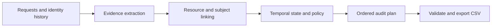

# Phantom Data

**Deletion auditing grounded in evidence.**

An audit engine for finding personal data that survives a deletion request—and the processes that can bring it back. Phantom Data connects current and historical identities across records, snapshots and local media, applies the supplied retention policy, and produces an ordered remediation and verification plan.

Built for HackerRank Orchestrate's [Ghost Data Still Exists](https://github.com/interviewstreet/hackerrank-orchestrate-october26/blob/main/problem_statement.md) challenge.

## What it does

- Resolves current and historical identifiers while checking for conflicting ownership.
- Reads CSV, JSON, SQLite-compatible SQL, logs, plain text, PDFs and screenshots.
- Reconstructs resource state at the request's audit cutoff instead of trusting workflow success messages.
- Identifies remaining records, exposed identifiers, active data flows and restore risks.
- Applies deletion, redaction, anonymization and retention rules, including permitted account tombstones.
- Exports deterministic, evidence-linked findings, remediation actions and verification checks.

Normal execution uses local OCR and deterministic reasoning. No paid model API or credentials are required.

## How it works



Structured parsers and local RapidOCR extract source facts. The planner keeps record treatment, retention obligations and recreation risks separate. An independent advisory checker examines source support without importing the planner's decisions.

## Verified results

| Check | Result |
|---|---:|
| Public-sample status accuracy | 100% — 32/32 |
| Public-sample exact ordered cases | 87.5% — 28/32 |
| Public-sample step F1 | 98.95% |
| Unit and regression tests | 139 passed, zero skipped with corpus regressions enabled |
| Independent synthetic evaluation cases | 14/14 exact |
| Evidence ingestion | 94/94 files processed |
| Full-dataset output | 518 requests, 3,127 steps |

The selected Version 3 output is byte-identical to the reviewed Version 2 baseline. The improvements strengthen reliability and tested edge-case behavior; they do not demonstrate higher prediction accuracy on this dataset. The public samples were repeatedly inspected during development, and hidden-test accuracy is unknown.

Fresh- and warm-cache runs from an extracted code archive reproduced the same CSV. The verified platform is **Python 3.12 on Windows x64**; Linux execution has not been verified.

## Quick start

Run these PowerShell commands from the extracted project directory:

```powershell
$work = Join-Path ([System.IO.Path]::GetTempPath()) "phantom-data-work"
New-Item -ItemType Directory -Force $work | Out-Null
python -m venv (Join-Path $work "venv")
$py = Join-Path $work "venv/Scripts/python.exe"
& $py -m pip install -r code/requirements-lock.txt

$env:GHOST_AUDIT_DATA_DIR = Read-Host "Path to the participant dataset directory"
$env:GHOST_AUDIT_CACHE_DIR = Join-Path $work "ocr-cache"
$env:PYTHONDONTWRITEBYTECODE = "1"

& $py -B code/main.py --data-dir $env:GHOST_AUDIT_DATA_DIR --out output.csv
```

Provide the official participant dataset separately. It must contain the request, identity, audit, activity, policy and evidence-manifest CSVs, together with the referenced evidence files. The corpus is read-only and is excluded from the code archive. Prediction code does not load sample answer files.

`code/requirements-lock.txt` pins the environment. PDF extraction uses pypdf; screenshot recognition uses the models bundled with RapidOCR and runs locally.

## Output

The generated CSV has exactly these columns:

```text
case_id,deletion_status,steps_json
```

| Status | Meaning |
|---|---|
| `COMPLETE` | The engine assesses completion and emits evidence-backed verification checks. |
| `INCOMPLETE` | Data or recreation risks remain, or completion cannot be established; supported findings and required future checks are emitted. |
| `NOT_APPLICABLE` | The request does not authorize deletion; `steps_json` is `[]`. |

Each step contains `step_no`, `phase`, `system_id`, `resource_id`, `operation`, `state` and `evidence_id`. Findings precede remediation, followed by verification. Future remediation and verification steps for incomplete cases use blank evidence references.

## Validate and evaluate

```powershell
# Validate row coverage, schema, operations, ordering and citation IDs/times.
& $py -B code/validate_output.py output.csv --data-dir $env:GHOST_AUDIT_DATA_DIR

# Inspect independent advisory evidence checks.
& $py -B code/check_evidence.py output.csv --data-dir $env:GHOST_AUDIT_DATA_DIR --report (Join-Path $work "evidence-check.json")

# Run the full test suite and independent synthetic cases.
$env:GHOST_AUDIT_TEST_DATA_DIR = $env:GHOST_AUDIT_DATA_DIR
& $py -B -m unittest discover -s code/tests -v
& $py -B code/evaluation/main.py --custom

# Generate and score the supplied public samples.
& $py -B code/main.py --data-dir $env:GHOST_AUDIT_DATA_DIR --requests sample_deletion_requests.csv --out (Join-Path $work "sample.csv")
& $py -B code/evaluation/main.py --pred (Join-Path $work "sample.csv") --gold (Join-Path $env:GHOST_AUDIT_DATA_DIR "sample_output.csv")
```

The scorer rejects malformed predictions and duplicate, missing or extra case IDs before measuring accuracy. Exact cases compare status and all seven ordered step fields. Step F1, positional field agreement and sequence metrics are reported separately.

The advisory checker reports detected contradictions and unresolved proof requirements. Passing structural validation or receiving no detected checker errors does not establish complete discovery or prove every conclusion.

## Reliability by design

| Safeguard | Behavior |
|---|---|
| Validated atomic publication | Serialization, contract checks and staged readback complete before the existing CSV or ZIP is replaced. |
| Evidence-coverage gate | Missing, failed or partially parsed evidence blocks normal output publication. |
| Restricted SQL | Snapshot execution runs in memory with an authorizer and execution/resource budgets. |
| Validated OCR caches | Entries bind source, engine, model and configuration hashes; corrupted or stale entries regenerate. |
| Read-only corpus boundaries | Output, report, cache and archive destinations are checked against protected paths. |

Use a new external `GHOST_AUDIT_CACHE_DIR` to measure fresh OCR, then repeat the run to check warm-cache equivalence. `--diagnostics`, `--summary` and `--usage` write optional run records outside the corpus.

## Scope and tradeoffs

The default `no-guess` policy excludes unresolved ownership ties but can use weak, uniquely inferred links. Pre-cutoff statements inside later exports may inform reconstruction; those exports cannot be cited. These assumptions, four unresolved public-sample verification gaps and other limitations are documented in the evaluation report.

Five broader semantic candidates remain opt-in after failing the measured promotion gates. `--candidate`, link-policy comparisons, strict capture mode and the optional `--llm` route require a separate output path. The paid-model route is unverified and is outside the verified release. Exploratory partial-evidence output is explicitly marked and unsuitable for submission.

## Project layout

```text
README.md
code/
  main.py                    # Audit CLI
  validate_output.py         # Independent output-contract checks
  check_evidence.py          # Advisory source-support checks
  package_submission.py      # Verified archive builder
  ghost_audit/               # Identity, evidence, state, policy and planning
  tests/                     # Regression, mutation and failure-injection tests
  evaluation/                # Scorer, independent fixtures and measured reports
  requirements-lock.txt      # Pinned dependencies
```

- [Evaluation report](code/evaluation/evaluation_report.md): metrics, custom cases, fixes and remaining limitations.
- [Usage report](code/evaluation/usage_report.md): final full-run OCR, cache, token and API-cost accounting.

## Build the submission archive

```powershell
& $py -B code/package_submission.py --out code.zip
```

The archive contains the runnable code, README, configuration, prompts, tests, independent fixtures and required reports. It excludes the participant corpus, environments, caches, generated runs, private transcripts and nested archives. Submit `output.csv` and the genuine development `log.txt` separately.
